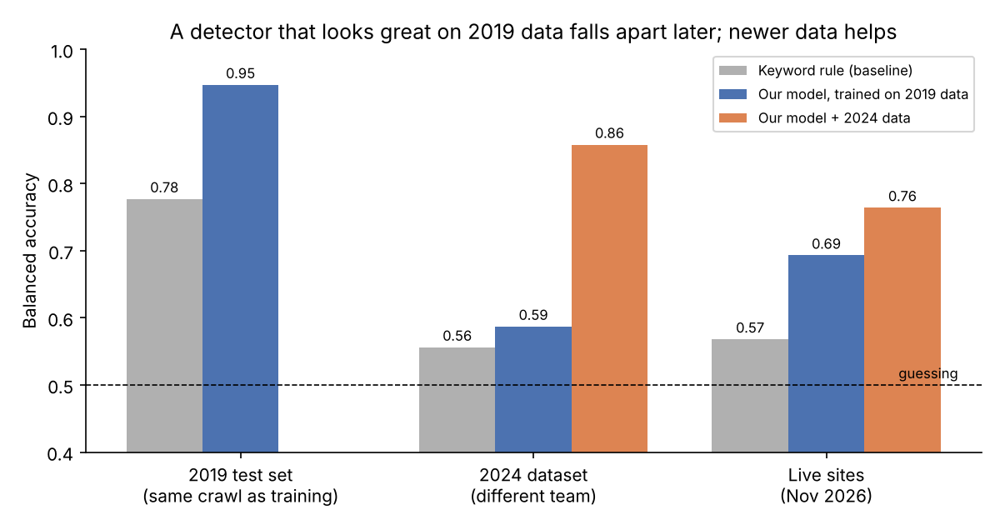

# Dark Pattern Detector

**Track:** AI + Finance
**Team:** Viraaj Burli, Rishi Datta, Neil Todkar

*This project is a prototype and is not financial advice.*

 · [Full report](REPORT.md) · [Data sheets](data/DATASHEETS.md)

> **Main takeaway:** a dark-pattern detector that scores 0.95 on the standard 2019 data drops to 0.59 on newer data, close to guessing. We measured that drop on live 2026 websites and fixed most of it with newer training data.

## The problem
"Only 2 left!", fake countdown timers and "No thanks, I don't want to save money" buttons push people to spend before they think. 76% of 642 sites and apps checked in a 2024 international review used at least one ([FTC](https://www.ftc.gov/news-events/news/press-releases/2024/07/ftc-icpen-gpen-announce-results-review-use-dark-patterns-affecting-subscription-services-privacy)). 1 in 5 Australians say these tricks made them spend more than they meant to, and young shoppers are 65% more likely to ([CPRC, 2022](https://cprc.org.au/dupedbydesign)). Our user is a teenager with their first debit card, who has the least money to lose. By our rough estimate, US shoppers lose $1.5 to $4 billion a year to purchases they didn't mean to make ([how we got this](REPORT.md#how-much-money-is-that-our-estimate)).

## What we built
- **In:** text pasted from a product or checkout page.
- **Out:** each manipulative phrase highlighted, with its trick type (urgency, scarcity, social proof, misdirection and so on) and one plain sentence on what it wants you to do.
- **Use:** before paying, a teen pastes the page into our Gradio app and sees that "Hurry! Sale ends in 02:14:37" is fake urgency. That moment of doubt is the point.

## What we added
Our own idea, with our own question: **does a detector trained on 2019 data still work years later, and can we fix it?** Most projects stop at a test split from the 2019 data. We tested on three sets the model never saw:
1. Unseen pages from the 2019 crawl.
2. A 2024 dataset built by a different team (CogniGuard, mostly Indian sites).
3. **Our own set:** 176 snippets from 15 live shopping, travel, ticket and game sites, collected on 15 November 2026.

## How it works
- **Data:** 2,349 labelled texts from Yada et al. (2022), built on Mathur et al.'s 2019 crawl. Cleaned of empty, duplicate and conflicting rows. Split 80/20 **by web page** so near-copies never leak into the test set.
- **Model:** TF-IDF (words and character chunks) plus logistic regression. It trains in seconds and its weights can be explained. The threshold is set by cross-validation on training data only, aiming for 90% recall, because a missed trick costs a teen money.

## Results

*Balanced accuracy averages recall on tricks and on normal text, so guessing scores 0.5. The orange bar on the 2024 set is trained on half of it and tested on the other half (mean of 5 splits).*

| Balanced accuracy | 2019 test | 2024 data | Live sites 2026 |
|---|---|---|---|
| Baseline: keyword rule | 0.78 | 0.56 | 0.57 |
| Our model (2019 data) | **0.95** | 0.59 | 0.69 |
| Our model + 2024 data | | **0.86** | **0.76** |

- **It beats the baseline everywhere.** On live sites it catches 60% of tricks, against 14% for the keyword rule.
- **It protects shoppers unequally.** Trained on 2019 data, it misses 77% of tricks on the mostly Indian 2024 data.
- **Part of the 2019 score is a shortcut.** A model that only counts length, digits, "!" and capitals gets F1 0.80 there.

**Where it fails:** new wording such as "116 booked" or "I'll Shop Without A Discount"; rule text that sounds urgent, such as "Cancel up to 24 hours in advance"; and visual tricks it can't see. The live set is small (35 tricks after removing overlaps), so its intervals are about ±0.09, and one person did the labelling. Details are in the [full report](REPORT.md#results).

## What we'd do next
1. Grow the live set to several hundred tricks, with two people labelling each one independently.
2. Test sentence embeddings, which understand meaning, on new wording.

## Sources
- **Datasets:** [Yada et al., 2022](https://github.com/yamanalab/ec-darkpattern) (Apache-2.0), built on [Mathur et al., 2019](https://github.com/aruneshmathur/dark-patterns); [CogniGuard, 2024](https://github.com/4darsh-Dev/CogniGaurd) (MIT, commit `09de733`); our live-site set, `data/live_sites_2026.csv`, copied from public pages and collected with AI assistance.
- **Statistics:** FTC, CPRC, Which?, Consumer NZ and others, all linked in the [full report](REPORT.md#research).
- **Libraries:** pandas, NumPy, scikit-learn, matplotlib, Gradio.
- **Tools:** Google Colab; Claude (Anthropic), used as an AI assistant for coding and drafting.

**Repo:** `notebooks/` holds the full project, saved with outputs (in Colab: Runtime → Run all, about a minute, ends with the live demo). `REPORT.md` has every number and failure case. `data/` holds the datasets and data sheets. `figures/` holds the charts (`scripts/make_summary_chart.py` draws the one above).
