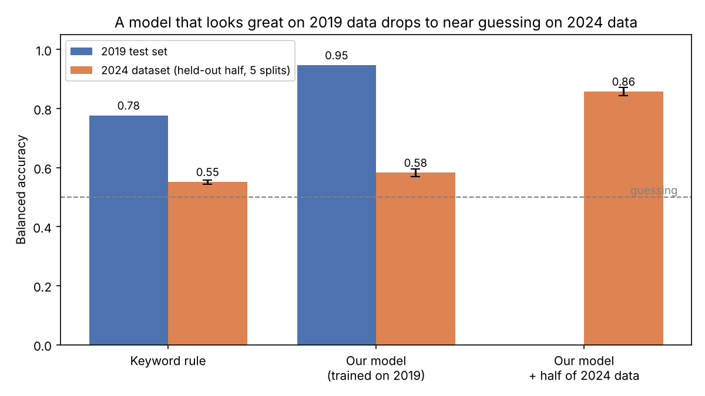

# Dark Pattern Detector: full report

This is the detailed version of the [one-page write-up](README.md). Every number here comes from the saved notebook, [`notebooks/Dark_Pattern_Detector.ipynb`](notebooks/Dark_Pattern_Detector.ipynb).

*This project is a prototype and is not financial advice.*

## Our unique angle: we test the detector the way the real world will
Most dark-pattern detectors train on the well-known 2019 dataset, report a high score on a test split from that same dataset, and stop there. That score tells you how well a model remembers 2019. We asked the question a shopper actually cares about: **does it still catch the tricks on the sites I use today?** To answer it, we tested one model across three points in time (2019, 2024 and live sites in 2026), and every number below comes from data the model never saw.

1. **A time-shift test across seven years.** We train on 2019 data and test on data from 2024 and 2026. A model with 0.95 balanced accuracy on 2019 data drops to 0.59 on a 2024 dataset built by a different team. That's close to guessing.
2. **Our own test set from live 2026 websites, collected this weekend.** We copied 176 snippets from 15 real shopping, travel, ticket and game sites on 15 November 2026 and kept them strictly held out. The model catches 46% of real tricks there, the keyword rule 14%.
3. **A fix that we measured.** Adding the 2024 data to training raises live-site balanced accuracy from 0.69 to 0.76, and recall from 46% to 60%. A settings tweak chosen by cross-validation moved scores by only about 0.01, and we report that honestly instead of tuning on the test set.
4. **An equal-protection check, which matters for a finance tool.** The 2019 model protects shoppers on the kinds of sites it was trained on far better than shoppers on sites from other countries (it misses 77% of tricks in the mostly Indian 2024 data), even though location is never an input.
5. **A shortcut check.** A model that never reads the words, only length, digits, "!" and capitals, already scores F1 0.80 on the 2019 data. Part of the published high scores comes from format, not meaning.
6. **Explanations and a page pressure score.** Every flag comes with the words that triggered it, taken straight from the model's weights. A page-level score (Low, Medium, High) says how much pressure the page stacks and what to check before paying. On held-out live sites, flagged trick counts per site track the real counts (Spearman 0.75 across 15 sites). See notebook Part 10b.
7. **Built for one specific user.** A teenager with their first debit card pastes a checkout page and gets each trick highlighted and explained in plain language before they pay.

## The problem
Teenagers shopping online with their first debit card run into manipulative design, known as "dark patterns". Examples are fake countdown timers, "only 2 left!", "27 people are viewing this" and guilt-trip buttons like "No thanks, I don't want to save money". These tricks push people to spend before they've thought it through, and a teen with little money and little shopping experience is the person they cost most.

## Research
We read the consumer-protection reports, surveys and academic papers on dark patterns before building anything. This is what they show, and what our own experiments added.

### How common and how costly is it?
Dark patterns are not a few bad apps. They are the normal way much of the web sells.
- **Most sites use them.** In a 2024 review of 642 subscription websites and apps by consumer-protection agencies in 26 countries, "nearly 76%" used at least one possible dark pattern and "nearly 67%" used several ([FTC, 2024](https://www.ftc.gov/news-events/news/press-releases/2024/07/ftc-icpen-gpen-announce-results-review-use-dark-patterns-affecting-subscription-services-privacy); the review did not decide whether each use was illegal). A European Commission check found manipulative practices on 148 of 399 online shops, including fake countdown timers on 42 of them ([report](https://www.malwarebytes.com/blog/news/2023/01/european-commission-goes-after-dark-patterns-in-web-shops)).
- **They make people spend money they didn't mean to.** In a survey of 2,078 UK adults, 13% remembered spending more than they intended because of a dark pattern and 6% bought something by accident ([Which?, 2023](https://www.which.co.uk/policy-and-insight/article/dark-patterns-aZhwY4p0gPTc)). In a controlled experiment, mild dark patterns made people more than twice as likely to sign up for a dubious paid service, and the price of the service stopped mattering ([Luguri & Strahilevitz, 2021](https://academic.oup.com/jla/article/13/1/43/6180579)).
- **Young people are hit hardest.** In a survey of 2,000 Australians, 1 in 5 spent more than they intended, and younger shoppers were 65% more likely to do so ([CPRC, 2022](https://cprc.org.au/dupedbydesign)). A quarter of New Zealanders kept a subscription longer than they meant to because of a dark pattern ([Consumer NZ, 2025](https://www.consumer.org.nz/articles/online-dark-designs-have-cost-new-zealanders-millions)).
- **People dislike being tricked.** In the same Which? survey, 45% said they felt manipulated or annoyed by dark patterns.

### How much money is that? Our estimate
No survey we found measures the dollars lost directly, so we built a rough estimate from cited inputs and one stated assumption:

| Input | Value | Source |
|---|---|---|
| US online retail sales, 2024 | $1.17 trillion | [Digital Commerce 360, from Commerce Department data](https://www.digitalcommerce360.com/article/us-ecommerce-sales/) |
| Share of shoppers who overspent because of a dark pattern | 13% to 33% | Which? (UK), CPRC (Australia), Consumer NZ |
| Extra spending by those shoppers, as a share of what they buy online | 1% | **our assumption** |

$1.17 trillion × 13% × 1% ≈ **$1.5 billion**, and $1.17 trillion × 33% × 1% ≈ **$3.9 billion**. So even if affected shoppers overspend by only 1 cent on every dollar, US shoppers lose roughly **$1.5 to $4 billion a year** to purchases they did not mean to make. This is an order-of-magnitude estimate, not a measurement: it assumes the survey shares from other countries apply in the US, and the 1% figure is our own guess. It still shows the scale: the Amazon settlement alone was reported at $2.5 billion.

### Why it's also a bad strategy for companies
In the Which? survey, 24% thought worse of the company afterwards and 16% stopped using the website or app. In the experiment, aggressive dark patterns "generated a powerful backlash among consumers". Regulators are also making them expensive: Epic Games paid $245 million to refund customers for dark patterns in Fortnite ([FTC, 2022](https://www.ftc.gov/news-events/news/press-releases/2022/12/fortnite-video-game-maker-epic-games-pay-more-half-billion-dollars-over-ftc-allegations)), and Amazon agreed to a reported $2.5 billion settlement in 2025 over Prime sign-up and cancellation tricks ([Fortune](https://fortune.com/2025/09/25/amazon-ftc-settlement-prime-automatic-renewal-lina-khan-dark-patterns/)). A tool that helps shoppers spot these tricks protects their money, and it also pushes companies to stop using them.

### What earlier detection work found
- **Mathur et al. (2019)** crawled about 11,000 popular shopping websites and found 1,818 dark-pattern instances on 1,254 of them ([paper](https://arxiv.org/abs/1907.07032)). Their labelled texts are the basis of the standard dataset.
- **Yada et al. (2022)** turned those texts into a training dataset and reported about 97% accuracy for their best model ([paper](https://arxiv.org/abs/2211.06543)). That test data comes from the same 2019 crawl as the training data, so it can't show whether a model keeps working as sites change.

### What our own research found
1. **Scores from 2019 data don't carry over.** Our model scores 0.95 balanced accuracy on unseen 2019 pages but 0.59 on an independent 2024 dataset, close to guessing.
2. **On live 2026 websites the gap is real but fixable.** Trained on 2019 data, the model catches 46% of tricks on 15 live sites. Adding the 2024 data raises that to 60%, against 14% for a keyword rule.
3. **Protection is unequal.** The 2019 model misses 77% of tricks on the mostly Indian 2024 data, so shoppers outside the regions the training data covered get less protection.
4. **Part of the published high scores is format, not meaning.** A model that only counts length, digits, "!" and capitals already reaches F1 0.80 on the 2019 data.

Full numbers are in [Results](#results).

## What we built
**In:** text pasted from a product or checkout page.
**Out:** every phrase that looks manipulative, highlighted, with the type of trick (urgency, scarcity, social proof, misdirection and so on) and one plain-language sentence on what it is trying to make you do.

This matters because the tricks are everywhere a teen shops: in the 2024 international review, 76% of the 642 sites and apps checked used at least one possible dark pattern ([FTC, 2024](https://www.ftc.gov/news-events/news/press-releases/2024/07/ftc-icpen-gpen-announce-results-review-use-dark-patterns-affecting-subscription-services-privacy)). A teen about to pay pastes the page text into our Gradio app and sees, for example, that "Hurry! Sale ends in 02:14:37" is fake urgency and that "No thanks, I don't care about protecting my stuff" is a guilt-trip button. A sensitivity slider lets them flag more or less.

**What changes for them:** instead of reacting to a countdown or an "only 2 left" banner in the moment, they get a pause and a reason to doubt the pressure before they spend money they may need for something else.

## What we added
Our own idea (not one of the suggested projects), plus **our own question**. A published model gets about 97% accuracy on dark patterns from a 2019 crawl of shopping sites. *Does a model trained on that data still work on dark patterns gathered independently, years later, by a different team, and if not, can we fix it?* To answer this we tested on a second public dataset from 2024 that we found ourselves. It is mostly from Indian shopping, travel, food-delivery and subscription sites. We did not collect it. We then added a third test of our own: 176 text snippets copied from 15 live shopping, travel, ticket and game sites on 15 November 2026.

## How it works
- **Training data:** Yada et al. (2022), built from Mathur et al.'s 2019 crawl. 2,349 texts after removing empty, duplicate and conflicting rows (1,178 dark patterns and 1,171 normal texts from the same pages).
- **Second dataset:** CogniGuard (2024, MIT licence). About 40% of its rows were copied from the 2019 data, so we removed every text that also appears there. That leaves 2,195 genuinely new rows (1,761 tricks, 434 normal). Many are templated near-copies, so we group texts with the same first four words and never split a group across train and test.
- **Live-site test set (ours):** 176 snippets from public pages on Booking.com, Agoda, Expedia, Hotels.com, Priceline, Walmart, Macy's, Temu, eBay, Fashion Nova, Steam, StubHub, Ticketmaster, GetYourGuide and Viator, labelled with the same categories as the 2019 data. 2 snippets that already appear in the training data are removed, leaving 174 (35 tricks, 139 normal). No reviews, names or account pages were copied. File: `data/live_sites_2026.csv`.
- **Split:** 80/20 **by web page**, so near-duplicate text from the same page (for example "Only 3 left" and "Only 2 left") can't be in both train and test.
- **Model:** TF-IDF features (words and 2 to 5 character chunks) with logistic regression. It trains in seconds and its weights are explainable. A second classifier, trained only on tricks, names the trick type (97% accurate on the 2019 test set).
- **Threshold:** chosen by 5-fold cross-validation on the training data only, aiming for at least 90% recall. For a teen, a missed trick that costs money is worse than an occasional false alarm. Chosen threshold: 0.70.

## Results
All numbers come from data the model did not see during training. "Balanced acc." is the average of recall on tricks and recall on normal text. Always guessing one answer scores 0.5 on it.

**2019 test set** (470 texts from 250 unseen pages, half tricks)

| Model | Balanced acc. | Precision | Recall | F1 |
|---|---|---|---|---|
| Baseline: always "trick" | 0.500 | 0.500 | 1.000 | 0.667 |
| Baseline: keyword rule ("only ... left", "hurry", "people viewing") | 0.777 | 1.000 | 0.553 | 0.712 |
| Shortcut check: length, digits, "!" and capitals only | 0.830 | 0.970 | 0.681 | 0.800 |
| **Our model** (threshold 0.70) | **0.947** | 0.986 | 0.906 | **0.945** |

**Second dataset, 2024** (80% of rows are tricks)

| Model | Balanced acc. | Precision | Recall | F1 |
|---|---|---|---|---|
| Baseline: always "trick" | 0.500 | 0.802 | 1.000 | 0.890 |
| Baseline: keyword rule | 0.556 | 0.995 | 0.115 | 0.207 |
| Our 2019-trained model, all 2,195 rows | 0.587 | 0.942 | **0.231** | 0.371 |
| Our model + half of the new data, tested on the other half (mean of 5 splits) | **0.858** | 0.973 | 0.809 | 0.883 |

**Live websites, November 2026** (174 snippets from 15 sites, 20% tricks; 95% intervals from 1,000 bootstrap resamples)

| Model | Balanced acc. (95% CI) | Precision | Recall (95% CI) | F1 |
|---|---|---|---|---|
| Baseline: always "trick" | 0.500 | 0.201 | 1.000 | 0.335 |
| Baseline: keyword rule | 0.568 (0.51 to 0.63) | 0.833 | 0.143 (0.03 to 0.27) | 0.244 |
| Our 2019-trained model | 0.693 (0.60 to 0.78) | 0.615 | 0.457 (0.29 to 0.62) | 0.525 |
| Our model + all of the 2024 data | **0.764** (0.68 to 0.85) | 0.677 | **0.600** (0.43 to 0.76) | **0.636** |

**95% confidence intervals** (1,000 bootstrap resamples): our model's balanced accuracy is 0.947 (0.926 to 0.964) on the 2019 test set and 0.587 (0.572 to 0.601) on the 2024 data. Recall falls from 0.906 (0.866 to 0.941) to 0.231 (0.211 to 0.252). The intervals don't come close to overlapping, so the drop is not bad luck.

**Main takeaway: the model that looks excellent on 2019 data catches only 23% of the tricks in the 2024 dataset.** It is still much better than the keyword rule. Retraining with half of the new data raises balanced accuracy from 0.58 to 0.86 (±0.01 over 5 splits). A tool like this has to be retrained as tricks change. On real websites in 2026 the picture is the same: the 2019 model catches 46% of the tricks, and adding the 2024 data raises that to 60%. The live-site set is small, so its intervals are wide and overlap, but both models clearly beat the keyword rule, which catches only 14%.

**What actually improved accuracy: more varied training data, not tuning.** Adding the 2024 data raised live-site balanced accuracy from 0.69 to 0.76. We also tried a settings tweak (treat every digit as the same symbol, so "116 booked" and "305 booked" match, and add word triples), chosen by cross-validation on training data only. It moved cross-validated balanced accuracy from 0.925 to 0.929 and live-site balanced accuracy from 0.764 to 0.778. Both changes are far smaller than the live-site confidence interval (about ±0.09), so we kept the simpler original settings and report the tweak in the notebook (Part 8c).

Things we noticed:
- **The surface-feature shortcut is real.** A model that never reads the words, only length, digits, "!" and capitals, already gets F1 0.80 on the 2019 data. The dark patterns in that data are short and full of numbers ("Only 2 left", "OFFER ENDS 00:54:59"), so part of the published high scores comes from format, not meaning. In the 2024 data the median text is 59 characters, against 25 in the 2019 data.
- **Splitting by page vs. at random made almost no difference** (F1 0.957 vs. 0.940). We had expected leakage to inflate the random split, but on this data it didn't.
- **F1 is misleading on the 2024 data.** Because 80% of its rows are tricks, "always say trick" gets F1 0.89, higher than our retrained model's 0.88. That's why we use balanced accuracy there: our retrained model gets 0.86 and the trivial baseline 0.50.

**Does it protect every shopper equally?** No, and this is the most important finding for a finance tool. Dark patterns are a global problem (the 2024 review was run by consumer agencies in 26 countries), so a detector that only works for one country's shoppers is not good enough. The 2019 training data comes from a crawl of popular English-language shopping sites, mostly aimed at US shoppers. On the 2024 dataset, which is mostly from Indian shopping, travel and food-delivery sites, the same model misses 77% of tricks. A shopper on the kinds of sites the training data didn't cover gets far less protection, even though nobody's location is an input to the model. Retraining with data from those sites closes most of the gap (balanced accuracy 0.58 to 0.86).

**Where it fails, and why we think so**
- *Trick types the 2019 data barely covers.* On the 2024 data, recall is 0% for Obstruction, 4% for Sneaking and 9% for Forced Action (for example "Sign in to see exclusive deals"). The 2019 training data has only 27, 12 and 4 examples of these.
- *Tricks written in full sentences.* Social proof like "Trusted by leading brands, bloggers, authors and influencers worldwide" was missed (confidence 3%). Only 9% of social-proof rows in that dataset are caught, because the 2019 social-proof examples are mostly short pop-ups like "30 people have purchased this item".
- *Guilt-trip buttons with unusual wording.* "I'll Shop Without A Discount" was missed (model confidence 9%), because it shares no words with the "No thanks" buttons the model learned.
- *False alarms on normal shop text.* "Sorry! This product is no longer available" (93%) and "Free shipping on orders over $50." (75%, labelled "urgency") are flagged because they sound like stock or deal messages.
- *New ways of showing popularity on live sites.* "116 booked" and "1.7K+sold" were missed by both models (confidence 5 to 32%). The 2019 data phrases social proof as sentences ("30 people have purchased this item"), so a bare number with "booked" or "sold" looks like a price or a count.
- *Policy text that sounds like scarcity.* On live sites, "There are no extra beds available at this property." (95%) and "Cancel up to 24 hours in advance for a full refund" (95%) were flagged as tricks. Words like "no ... available" and time limits are strong trick signals in the training data, even when the sentence is just a rule.
- *Text only.* Many tricks are visual (42 of the 399 shops in the EU sweep used fake countdown timers, which are often drawn as graphics), such as tiny grey "decline" links and pre-ticked boxes, and the tool can't see them.
- *English only.* The 2024 dataset was not collected from live sites by us, and many of its rows look hand-written or generated. Our live-site set fixes that, but it is small (35 tricks) and was labelled by one labeller, so its labels have not been checked by a second person.

## What we'd do next
The goal is a tool that keeps up as tricks change, because the cost of falling behind is real money for the shoppers least able to afford it.

1. Grow the live-site test set to several hundred tricks from more sites, with two people labelling each snippet independently to measure agreement.
2. Try sentence embeddings (optional Part 9 in the notebook) to see if a model that understands meaning holds up better on new wording than one that matches words.

## Sources
- **Training dataset:** Y. Yada, J. Feng, T. Matsumoto, N. Fukushima, F. Kido, H. Yamana. *Dark patterns in e-commerce: a dataset and its baseline evaluations.* IEEE BigData 2022. https://github.com/yamanalab/ec-darkpattern (Apache-2.0), arXiv: https://arxiv.org/abs/2211.06543
- **Original dark pattern collection:** A. Mathur et al. *Dark Patterns at Scale: Findings from a Crawl of 11K Shopping Websites.* CSCW 2019. https://github.com/aruneshmathur/dark-patterns
- **Second dataset:** CogniGuard dark-pattern dataset, Adarsh Maurya et al., 2024 (MIT). https://github.com/4darsh-Dev/CogniGaurd, file `django-mlapi-backend/datasets/dp_final_dataset_may_4k.csv`, commit `09de733`
- **Live-site test set:** text copied from public pages of the 15 sites listed above on 15 November 2026, collected with AI assistance
- **Statistics:** FTC (2024, 2022), European Commission sweep (2023) as reported by Malwarebytes, Which? consumer survey (2023), Luguri & Strahilevitz, *Journal of Legal Analysis* (2021), Fortune (2025), Consumer Policy Research Centre *Duped by Design* (2022), Consumer NZ (2025), Digital Commerce 360 (2026, US ecommerce sales from Commerce Department data); links are inline above. The dollar estimate is our own calculation from these inputs
- **Libraries:** pandas, NumPy, scikit-learn, matplotlib, Gradio
- **Tools:** Google Colab; Claude (Anthropic), used as an AI assistant for coding and drafting

## Repo layout
- `notebooks/Dark_Pattern_Detector.ipynb`: the full project, saved with outputs. To run it yourself, open it in Colab and choose Runtime → Run all. It takes about a minute, and the last part launches the live demo.
- `figures/results.png`: the main results chart, made by the notebook.
- `data/live_sites_2026.csv`: our live-site test set.
- `data/DATASHEETS.md`: a data sheet for each dataset (source, size, columns, how it was made, licence, limitations).
- `data/README.md`: what each dataset is, where it comes from and its licence.
